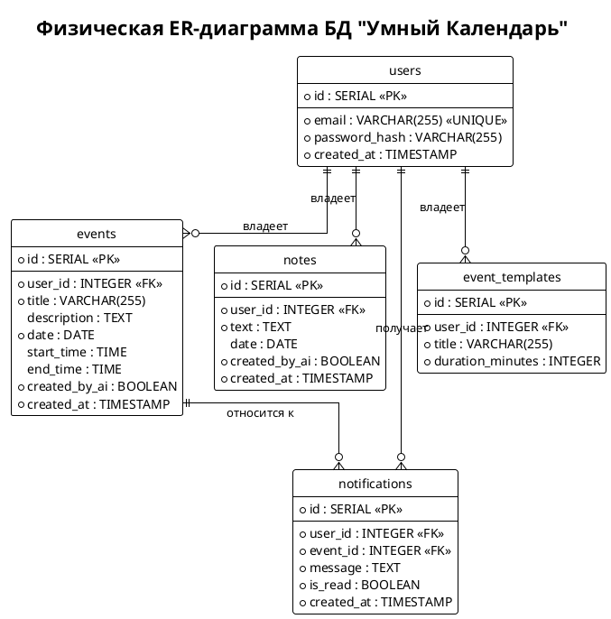

Отлично, переходим к **Заданию 2. Проектирование физической модели базы данных**.

Цель этого задания — уточнить логическую модель, созданную в 3-й лабораторной, и представить её в виде таблицы (как на Рис. 2 методички), физической ER-диаграммы (Рис. 3) и SQL-скрипта.

Судя по вашему `models.py` и `docker-compose.yml`, вы используете **PostgreSQL** и **SQLAlchemy**. Поэтому мы будем использовать типы данных, соответствующие этой СУБД.

Ниже подготовлены все три артефакта, которые нужно добавить в вашу документацию.

---

### 1. Логическая схема базы данных (Таблица)

Этот блок нужно вставить в Wiki (раздел «Схема базы данных»).

**Таблица 2.1. Логическая схема базы данных приложения «Умный Календарь»**

| Сущность | Таблица БД | Поле | Смысл поля | Тип данных |
| :--- | :--- | :--- | :--- | :--- |
| **Пользователь** | `users` | `id` | Уникальный идентификатор | SERIAL (PK) |
| | | `email` | Электронная почта (логин) | VARCHAR(255) |
| | | `password_hash` | Хэш пароля (bcrypt) | VARCHAR(255) |
| | | `created_at` | Дата и время регистрации | TIMESTAMP |
| **Событие** | `events` | `id` | Уникальный идентификатор | SERIAL (PK) |
| | | `user_id` | ID владельца события | INTEGER (FK) |
| | | `title` | Заголовок события | VARCHAR(255) |
| | | `description` | Описание события | TEXT |
| | | `date` | Дата события | DATE |
| | | `start_time` | Время начала | TIME |
| | | `end_time` | Время окончания | TIME |
| | | `created_by_ai` | Флаг: создано через AI | BOOLEAN |
| | | `created_at` | Дата и время создания записи | TIMESTAMP |
| **Заметка** | `notes` | `id` | Уникальный идентификатор | SERIAL (PK) |
| | | `user_id` | ID владельца заметки | INTEGER (FK) |
| | | `text` | Текст заметки | TEXT |
| | | `date` | Дата привязки (опционально) | DATE |
| | | `created_by_ai` | Флаг: создано через AI | BOOLEAN |
| | | `created_at` | Дата и время создания записи | TIMESTAMP |
| **Шаблон события** | `event_templates` | `id` | Уникальный идентификатор | SERIAL (PK) |
| | | `user_id` | ID владельца шаблона | INTEGER (FK) |
| | | `title` | Название шаблона (например, "Пара") | VARCHAR(255) |
| | | `duration_minutes` | Длительность по умолчанию (в минутах) | INTEGER |
| **Уведомление** | `notifications` | `id` | Уникальный идентификатор | SERIAL (PK) |
| | | `user_id` | ID получателя | INTEGER (FK) |
| | | `event_id` | ID связанного события | INTEGER (FK) |
| | | `message` | Текст уведомления | TEXT |
| | | `is_read` | Флаг: прочитано ли уведомление | BOOLEAN |
| | | `created_at` | Дата и время создания уведомления | TIMESTAMP |

---

### 2. Физическая ER-диаграмма (PlantUML)

Этот код можно отрендерить в онлайн-редакторе PlantUML (он не требует внешних библиотек, поэтому должен сработать без ошибок) и сохранить как картинку для отчета.



---

### 3. SQL-скрипт создания БД

Этот код сохраните в файл `schema.sql` (или `init.sql`), положите в репозиторий и добавьте ссылку на него в Wiki.

```sql
-- Создание таблицы пользователей
CREATE TABLE users (
    id SERIAL PRIMARY KEY,
    email VARCHAR(255) UNIQUE NOT NULL,
    password_hash VARCHAR(255) NOT NULL,
    created_at TIMESTAMP NOT NULL DEFAULT CURRENT_TIMESTAMP
);

-- Создание таблицы событий
CREATE TABLE events (
    id SERIAL PRIMARY KEY,
    user_id INTEGER NOT NULL REFERENCES users(id) ON DELETE CASCADE,
    title VARCHAR(255) NOT NULL,
    description TEXT,
    date DATE NOT NULL,
    start_time TIME,
    end_time TIME,
    created_by_ai BOOLEAN NOT NULL DEFAULT FALSE,
    created_at TIMESTAMP NOT NULL DEFAULT CURRENT_TIMESTAMP
);
-- Индекс для быстрого поиска событий пользователя по дате
CREATE INDEX idx_events_user_date ON events(user_id, date);

-- Создание таблицы заметок
CREATE TABLE notes (
    id SERIAL PRIMARY KEY,
    user_id INTEGER NOT NULL REFERENCES users(id) ON DELETE CASCADE,
    text TEXT NOT NULL,
    date DATE,
    created_by_ai BOOLEAN NOT NULL DEFAULT FALSE,
    created_at TIMESTAMP NOT NULL DEFAULT CURRENT_TIMESTAMP
);
-- Индекс для поиска заметок пользователя
CREATE INDEX idx_notes_user_date ON notes(user_id, date);

-- Создание таблицы шаблонов событий
CREATE TABLE event_templates (
    id SERIAL PRIMARY KEY,
    user_id INTEGER NOT NULL REFERENCES users(id) ON DELETE CASCADE,
    title VARCHAR(255) NOT NULL,
    duration_minutes INTEGER NOT NULL
);

-- Создание таблицы уведомлений
CREATE TABLE notifications (
    id SERIAL PRIMARY KEY,
    user_id INTEGER NOT NULL REFERENCES users(id) ON DELETE CASCADE,
    event_id INTEGER REFERENCES events(id) ON DELETE CASCADE,
    message TEXT NOT NULL,
    is_read BOOLEAN NOT NULL DEFAULT FALSE,
    created_at TIMESTAMP NOT NULL DEFAULT CURRENT_TIMESTAMP
);
-- Индекс для быстрого получения непрочитанных уведомлений пользователя
CREATE INDEX idx_notifications_user_unread ON notifications(user_id, is_read);
```

---
