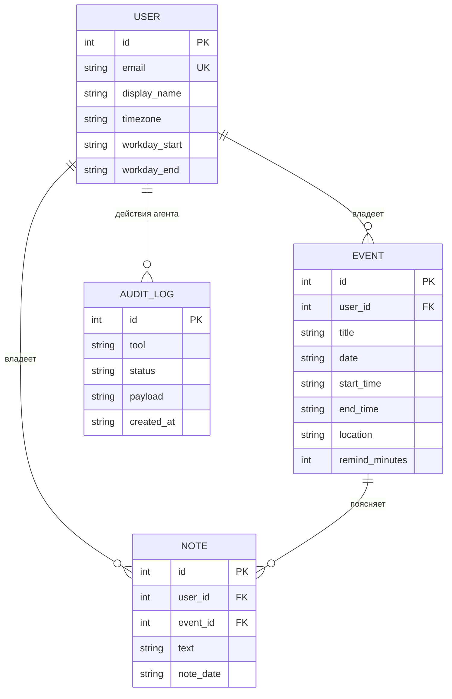
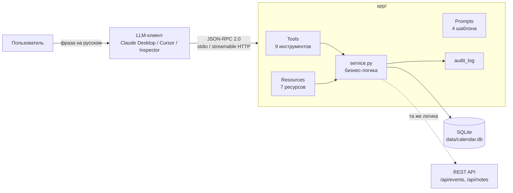
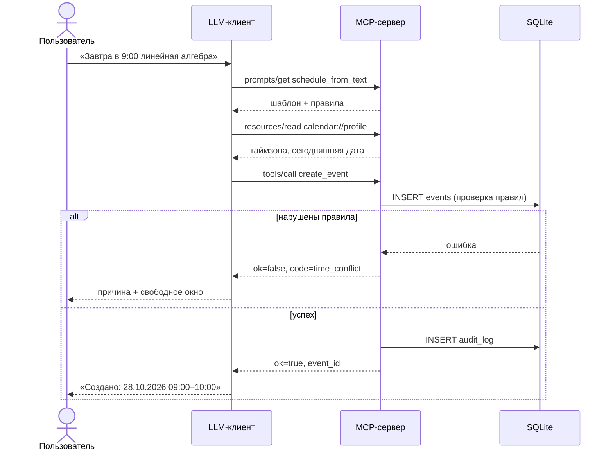

# MCP-сервер «AI Calendar» — проектирование и реализация

> Страница для **wiki** и **GitHub Pages** проекта «Умный Календарь».
> Материал задания 5 лабораторной работы № 4 (ПЧМИ): архитектура MCP-сервера,
> JSON-схемы Tools, описание Resources и Prompts, инструкция по развертыванию
> и примеры запросов. Инструкция по установке также продублирована в
> [README.md](../README.md).

## Содержание

1. [Контекст и цель](#1-контекст-и-цель)
2. [Анализ предметной области: сущности](#2-анализ-предметной-области-сущности)
3. [Архитектура MCP-сервера](#3-архитектура-mcp-сервера)
4. [MCP Tools и их JSON-схемы](#4-mcp-tools-и-их-json-схемы)
5. [MCP Resources](#5-mcp-resources)
6. [MCP Prompts](#6-mcp-prompts)
7. [Валидация и безопасность агента](#7-валидация-и-безопасность-агента)
8. [Логирование действий агента](#8-логирование-действий-агента)
9. [Сценарии взаимодействия](#9-сценарии-взаимодействия)
10. [Тестирование](#10-тестирование)
11. [Развертывание](#11-развертывание)
12. [Ограничения и развитие](#12-ограничения-и-развитие)

---

## 1. Контекст и цель

Приложение «Умный Календарь» позволяет вести события и заметки и общаться с
AI-ассистентом на естественном языке: «Завтра в 9:00 линейная алгебра»,
«Найди два часа на подготовку», «Что у меня в пятницу?».

До задания 4 ассистент работал через эндпоинт `POST /api/ai/chat`, то есть
**сервер сам** вызывал LLM. MCP меняет схему интеграции: LLM-клиент (Claude Desktop,
Cursor, собственный чат-бот) подключается к **MCP-серверу** и сам решает, какой
инструмент вызвать. Сервер отвечает за типизацию аргументов, проверку правил и
доступ к данным.

Цель MVP:

- описать сущности системы и действия, доступные агенту;
- спроектировать JSON-схемы Tools, набор Resources и шаблоны Prompts;
- реализовать сервер с mock-базой SQLite и проверить его MCP Inspector / клиентом.

## 2. Анализ предметной области: сущности

| Сущность | Атрибуты | Связи |
| --- | --- | --- |
| **User** | id, email, display_name, timezone, workday_start, workday_end | 1 → N Event, 1 → N Note |
| **Event** | id, user_id, title, description, location, date, start_time, end_time, remind_minutes, source | N → 1 User, 1 → N Note |
| **Note** | id, user_id, text, note_date, event_id | N → 1 User, N → 0..1 Event |
| **AuditLog** | id, tool, user_id, payload, status, detail, created_at | служебная, N → 0..1 User |



Полная DDL-схема — [`schema.sql`](../schema.sql). Она совпадает с логической
моделью из лабораторных работ 1–3; физическая модель для SQLite отличается только
типами (`TEXT` для даты и времени, `INTEGER PRIMARY KEY AUTOINCREMENT`).

## 3. Архитектура MCP-сервера

Источник диаграмм: [`docs/mcp-architecture.puml`](mcp-architecture.puml)
(PlantUML: компонентная диаграмма и sequence-диаграмма).
Готовые изображения: `docs/img/mcp-architecture.png`, `docs/img/mcp-sequence.png`.




Слои и ответственность:

| Слой | Файл | Ответственность |
| --- | --- | --- |
| Транспорт и протокол | `app/server.py` | создание сервера, выбор SDK-API (1.x/2.x), stdio/HTTP |
| Контракт MCP | `app/tools.py`, `app/resources.py`, `app/prompts.py` | схемы аргументов, текстовые представления, шаблоны |
| Бизнес-логика | `app/service.py` | CRUD, правила, свободные слоты, аудит |
| Данные | `app/db.py`, `schema.sql` | подключение, схема, демо-данные |
| Ошибки | `app/errors.py` | `DomainError` → структурированный код для агента |

Ключевое проектное решение: **Tools не дублируют бизнес-правила**. Слой
`service.py` один и тот же для MCP и для REST; это гарантирует, что агент не сможет
создать событие, которое запрещено API.

## 4. MCP Tools и их JSON-схемы

Схемы генерируются автоматически из сигнатур Python + `pydantic.Field(description=...)`,
поэтому всегда соответствуют коду. Фактический дамп — [`tools-schemas.json`](tools-schemas.json).

### 4.1. `create_event` — создание события

```json
{
  "name": "create_event",
  "description": "Создать событие в календаре.\n\nПравила: дата не в прошлом, end_time позже start_time, ...",
  "inputSchema": {
    "type": "object",
    "properties": {
      "title":         {"type": "string",  "description": "Название события, например «Линейная алгебра»."},
      "date":          {"type": "string",  "description": "Дата в формате YYYY-MM-DD, например 2026-10-27."},
      "start_time":    {"type": "string",  "description": "Время в формате HH:MM, например 14:00."},
      "end_time":      {"anyOf": [{"type": "string"}, {"type": "null"}], "default": null,
                        "description": "Время HH:MM; null — рассчитать автоматически."},
      "description":   {"anyOf": [{"type": "string"}, {"type": "null"}], "default": null,
                        "description": "Необязательное описание события."},
      "location":      {"anyOf": [{"type": "string"}, {"type": "null"}], "default": null},
      "remind_minutes":{"anyOf": [{"type": "integer"}, {"type": "null"}], "default": null},
      "user_id":       {"type": "integer", "default": 1}
    },
    "required": ["title", "date", "start_time"]
  }
}
```

### 4.2. Полный перечень Tools

| Tool | Аргументы (required — жирным) | Возвращает |
| --- | --- | --- |
| `list_events` | *start_date, end_date, query, limit, user_id* | период, количество, массив событий |
| `get_day_plan` | **date**, *user_id* | события, заметки, конфликты, загрузка, свободные окна |
| `find_free_slots` | **date**, *duration_minutes*, *user_id* | рабочие часы, занятость, окна, `recommended_slot` |
| `create_event` | **title**, **date**, **start_time**, *end_time*, *description*, *location*, *remind_minutes* | созданное событие + предупреждения |
| `update_event` | **event_id**, *остальные поля* | обновлённое событие |
| `delete_event` | **event_id**, *confirm* | удалённое событие |
| `create_note` | **text**, *note_date*, *event_id* | созданная заметка |
| `search_notes` | *query*, *note_date*, *limit* | количество, массив заметок |
| `delete_note` | **note_id**, *confirm* | удалённая заметка |

Единый контракт ответа:

```json
{"ok": true,  "result": { ... }}
{"ok": false, "error": {"code": "time_conflict", "message": "...", "hint": "...", "details": [...]}}
```

Почему так: MCP возвращает агенту текст, а не HTTP-код. Структурированный
`error.code` позволяет LLM выбрать правильную стратегию (переспросить, предложить
другое время, показать конфликт), а `details` — сразу отрисовать конфликты
пользователю, без дополнительного запроса.

### 4.3. Сопоставление с REST API

| REST | MCP Tool |
| --- | --- |
| `GET /api/events/` | `list_events` |
| `POST /api/events/` | `create_event` |
| `DELETE /api/events/{id}` | `delete_event` (`confirm=true`) |
| `GET /api/notes/` | `search_notes` |
| `POST /api/notes/` | `create_note` |

Перенос и удаление заметок расширяют API: они нужны агенту для сценариев
«перенеси встречу», «удали заметку».

## 5. MCP Resources

| URI | Тип | Содержимое | Зачем агенту |
| --- | --- | --- | --- |
| `calendar://profile` | статический | имя, таймзона, рабочие часы, сегодняшняя дата | переводить «завтра» в `YYYY-MM-DD` |
| `calendar://events/{date}` | шаблон | markdown-таблица событий дня, заметки, конфликты | отвечать «что у меня в среду» |
| `calendar://week/{start_date}` | шаблон | 7 дней с событиями | планирование недели |
| `calendar://rules/scheduling` | статический | 10 правил планирования | соблюдать ограничения |
| `calendar://audit/recent` | статический | последние 10 действий агента | самопроверка, отчёт пользователю |
| `notes://recent` | статический | последние 10 заметок | контекст |
| `notes://by-date/{date}` | шаблон | заметки конкретной даты | сводка дня |

Ресурсы отдают `text/markdown` — LLM читает их без парсинга JSON, а человек видит
то же самое в MCP Inspector.

## 6. MCP Prompts

| Prompt | Аргументы | Содержание шаблона |
| --- | --- | --- |
| `plan_week` | `start_date`, `goal` | прочитать профиль, неделю и правила; при нехватке времени вызвать `find_free_slots`; создать события только после согласия |
| `schedule_from_text` | `text`, `today` | извлечь название/дату/время, перевести относительные даты, вызвать `create_event`, обработать `time_conflict` через `find_free_slots` |
| `resolve_conflicts` | `date` | взять `conflicts` из `get_day_plan`, предложить перенос через `update_event`, не удалять без `confirm` |
| `daily_briefing` | `date` | прочитать события и заметки дня, найти свободное окно, дать сводку в 3–7 предложениях |

Промпты — это «сценарии использования» из реестра вариантов использования
лабораторной работы № 1: планирование недели, быстрое добавление события,
разрешение накладок, утренняя сводка.

## 7. Валидация и безопасность агента

Правила из `calendar://rules/scheduling`:

1. дата события не в прошлом;
2. `end_time > start_time`, событие не переходит через полночь;
3. нет пересечений по времени;
4. нет дубликатов (название + дата + время начала);
5. не более 12 событий в день;
6. событие вне рабочих часов допустимо, но с предупреждением;
7. удаление — только после `confirm=true`;
8. ограничения длины текста (200 / 2000 / 5000);
9. относительные даты переводятся по таймзоне пользователя;
10. при нехватке данных агент задаёт вопрос, а не выдумывает значения.

Дополнительно:

- **принадлежность данных**: все запросы фильтруются по `user_id`, чужое событие
  неотличимо от несуществующего (`event_not_found`);
- **подтверждение удаления**: `delete_event`/`delete_note` без `confirm=true`
  возвращают `confirmation_required` и описание объекта — аналог запрета
  «отменить уже доставленный заказ» из примера задания;
- **лимит периода**: не более 62 дней в одном `list_events`, чтобы агент не
  вычитывал всю базу;
- **санитизация ввода**: даты и время проверяются регулярными выражениями,
  текст ограничен по длине, SQL-запросы параметризованы.

## 8. Логирование действий агента

Каждый вызов Tool попадает в `audit_log` (таблица в mock-БД):

```sql
INSERT INTO audit_log (tool, user_id, payload, status, detail, created_at)
VALUES ('create_event', 1, '{"title": "Линейная алгебра", "date": "2026-10-28"}', 'ok', NULL, '2026-10-27T17:21:03');
```

Статусы: `ok` — выполнено; `rejected` — нарушено бизнес-правило; `error` —
внутренняя ошибка. Агент может прочитать журнал ресурсом `calendar://audit/recent`
и честно ответить «я создал событие, но предыдущий запрос был отклонён из-за
конфликта».

## 9. Сценарии взаимодействия

### 9.1. «Завтра в 9:00 линейная алгебра»




### 9.2. «Найди два часа в пятницу»

`find_free_slots(date="2026-10-30", duration_minutes=120)` → агент получает окна
`08:30–18:30` (600 мин) и `20:00–22:00` (120 мин), предлагает лучшее.

### 9.3. «Удали созвон с заказчиком»

`delete_event(event_id=7)` → `confirmation_required` с описанием события →
пользователь подтверждает → `delete_event(event_id=7, confirm=true)` → `ok`.

### 9.4. «Спланируй неделю»

`prompts/get plan_week` → `calendar://week/{start_date}` → `find_free_slots` по
перегруженным дням → предложение плана → `create_event` после согласия.

## 10. Тестирование

| Уровень | Инструмент | Что проверяет |
| --- | --- | --- |
| Юнит | `pytest tests/test_service.py` | правила, CRUD, слоты, заметки, аудит (18 тестов) |
| Интеграция | `pytest tests/test_mcp_smoke.py` | реальный сервер через stdio: `initialize`, списки, вызовы, ресурсы, промпты, коды ошибок |
| Ручное | MCP Inspector (`npx @modelcontextprotocol/inspector python -m app.server`) | формы аргументов, JSON Schema, чтение ресурсов, промпты |
| Клиент LLM | Claude Desktop / Cursor / кастомный Python-клиент | сценарии из раздела 9 |

Результат прогона:

```
19 passed in 6.83s
```

Схемы снимаются с работающего сервера:

```powershell
python scripts/dump_schemas.py   # → docs/tools-schemas.json
python scripts/demo_scenario.py  # диалоги из раздела 9 → docs/demo-run.txt
```

Транскрипт демонстрационного прогона (реальные ответы сервера):
[`demo-run.txt`](demo-run.txt).

## 11. Развертывание

### 11.1. Локально, без контейнера

```powershell
git clone <repo-url>
cd ai-calendar-mcp
python -m venv .venv
.venv\Scripts\Activate.ps1
pip install -r requirements.txt
python -m app.server
```

- БД создаётся автоматически (`data/calendar.db`) и наполняется демо-данными;
- переменные окружения — `CALENDAR_DB_PATH`, `CALENDAR_TZ`, `CALENDAR_USER_ID`,
  `CALENDAR_SEED`, `CALENDAR_MAX_EVENTS_PER_DAY`, `MCP_TRANSPORT`, `MCP_HOST`, `MCP_PORT`;
- режим HTTP: `MCP_TRANSPORT=streamable-http`, эндпоинт `http://127.0.0.1:8000/mcp`;
- подключение к Claude Desktop / Cursor / Inspector — в [README.md](../README.md#подключение-к-llm-клиентам).

### 11.2. Docker

Образ собирается многоэтапно (`Dockerfile`): зависимости ставятся в отдельном
слое, в runtime попадают только `app/`, `schema.sql`, `server.py`; процесс
работает от непривилегированного пользователя `mcp` (uid 10001), БД хранится
в томе `/data`.

```powershell
docker build -t ai-calendar-mcp:1.0.0 .
docker run -i --rm ai-calendar-mcp:1.0.0                 # stdio для MCP-клиента
docker compose up --build -d                             # HTTP + healthcheck + том
```

Особенности, которые важно знать при эксплуатации:

| Особенность | Причина / решение |
| --- | --- |
| `docker run -i` (без `-t`) | MCP stdio — это JSON-RPC по stdin/stdout; TTY исказит поток |
| `MCP_HOST=0.0.0.0` | по умолчанию сервер слушает 127.0.0.1, и `-p 8000:8000` не сработает |
| том `/data` | SQLite-файл должен переживать перезапуск контейнера |
| uid 10001 | bind-mount с хоста на Linux требует `chown 10001` |
| healthcheck в compose | в stdio-режиме порт не слушается, проверка в образе давала бы ложные падения |
| `python:3.12-slim` | slim-образ без системной tzdata, поэтому `tzdata` ставится из `requirements.txt` |

Автоматическая проверка образа (собирает и проходит сценарий через контейнер):

```powershell
python scripts/docker_smoke.py
```

### 11.3. Проверка после запуска

```powershell
pytest -q                       # 19 passed
python scripts/dump_schemas.py  # tools=9, resources=4, templates=3, prompts=4
python scripts/docker_smoke.py  # если установлен Docker: образ отвечает по MCP
```

## 12. Ограничения и развитие

| Ограничение MVP | План |
| --- | --- |
| один демо-пользователь | JWT из REST API, `user_id` в контексте запроса, OAuth для MCP |
| SQLite-файл | PostgreSQL + миграции (Alembic), репозиторий `app/db.py` |
| нет повторяющихся событий | RRULE-расширение и Tool `create_recurring_event` |
| нет напоминаний | планировщик уведомлений, Tool `snooze_reminder` |
| разбор фразы — на стороне LLM | добавить Prompt с few-shot примерами дат на русском |
| нет CI/CD | GitHub Actions: pytest + сборка образа, публикация в registry, деплой |

---

**Связанные материалы:** [README MCP-сервера](../README.md) ·
[PlantUML-диаграммы](mcp-architecture.puml) ·
[JSON-схемы](tools-schemas.json) · [DDL mock-БД](../schema.sql)
